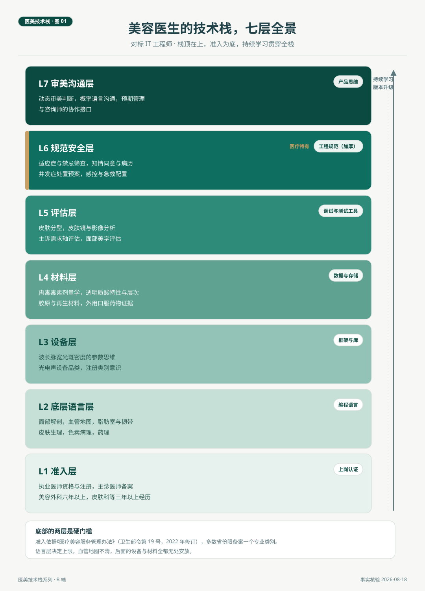

# 美容医生的技术栈全景

> 一位医生会什么，行业里习惯用仪器名单来回答，这是对专业最大的低估。把美容医生的能力画成一张七层技术栈地图，准入、底层语言、设备、材料、评估、规范安全、审美沟通，专业就变成可核对、可学习、可升级的清单。这张图对标的是 IT 工程师的栈图体例，多出来的那一层规范安全，正是这个行业专业性的制度表达。

*医美技术栈 · 第 01 篇 / 共 10 篇 · 医生篇 · 事实核验时间 2026 年 8 月 18 日*

---

## 场景与问题

2026 年 8 月，一位刚结束皮肤科规培的医生入职一家美容皮肤科诊所。店长希望她一个月内独立承接光电治疗，交给她的资料是五本设备说明书。她晚上在笔记本上把自己会的东西列了一遍，解剖、药理、激光原理、注射技巧、问诊话术，越列越长，也越列越乱。她发现一个问题。这些能力之间是什么关系，先学什么后学什么，缺了哪一块会出事，没有人给过她一张画全的图。

这个场景在行业里反复发生。医生的培养靠科室轮转、厂家培训和个人摸索，能力结构散落在各处，就是没有一张总图。IT 行业很早就解决了这个问题，程序员的技能被画成分层技术栈，语言在底、框架在中、规范在顶，新人按图学习，招聘按图核对，市场按图定价。这一篇把同样的方法用在美容医生身上，给出七层的栈图，并回答两个问题。医生的专业到底由什么构成，这张图可以怎么用。

## 一、栈不是清单，是结构

清单是把会的东西列出来，栈是把它们按依赖关系摆好。IT 工程师的栈有一条清晰的逻辑，上层依赖下层，语言不通，框架白学；框架不熟，工具白装。医生的能力同样有依赖关系，解剖不清，注射就是盲操作；药理不清，参数就是数字游戏。栈图的价值不在多列几个条目，在于把这种依赖摆出来，让学习有次序，让自检有重点。

常见的错觉是用仪器名单代替栈图。一位医生说自己会操作四台设备，这在栈图里只占了三分之一层。设备是框架，会按键不等于会用框架开发应用，框架之上跑的东西叫方案，方案的质量取决于栈底的语言层和栈顶的规范层。投资尽调时这个错觉最常见，也最贵，设备清单齐全的机构，医生栈未必完整，因为设备是买得来的，栈的其他六层买不来。

栈有三个特征，可核对、可学习、可升级。可核对，指每一层都能列出具体条目逐项确认。可学习，指层与层的依赖给出学习次序，自底向上。可升级，指栈的内容随共识、法规、设备的迭代而更新，医生的知识需要版本管理，这一点后面的篇目会反复用到。

## 二、七层逐层看

**准入层，能上岗的认证。** 这是最硬的一层。《医疗美容服务管理办法》（卫生部令第 19 号，2022 年修订）规定，负责实施医疗美容项目的主诊医师须为注册执业医师，美容外科要求六年以上相关临床工作经历，美容皮肤科等专业一般要求三年以上，并经医疗美容专业培训或进修合格，具体条件按省级细则备案，多数省份限备案一个专业类别。这一层不谈水平，只谈资格，但它是整张栈的地基，缺了它，上面六层都没有意义。

**底层语言层，解剖、生理、病理、药理。** 一切操作都写在这门语言上。面部血管地图决定注射路径，组织层次决定注入位置，色素病理决定激光参数，药理决定剂量与间隔。第 02 篇会单独展开这一层，因为它最重，也最容易被低估。

**设备层，能量源平台。** 对标 IT 的框架与库。激光、射频、聚焦超声、强脉冲光，每一类设备是一个能力平台，医生在平台上开发的应用叫方案。这一层的核心思维是参数思维，波长、脉宽、光斑、密度，同样的设备在不同的参数下是不同的治疗。注册类别意识也属于这一层，射频治疗仪 2024 年 4 月起须持第三类医疗器械注册证方可生产销售，聚焦超声 2025 年 11 月出现国内首张三类证，激光类一直按具体产品注册管理。医生不需要背法规条文，但需要知道手里的设备处在什么监管位置。

**材料层，写进去的东西。** 注射与外用药物对标数据写入，层次是写入位置，剂量是写入量。A 型肉毒毒素按毒性药品类别管理，剂量与弥散范围是这一层的语法。透明质酸的特性里最值得记住的是可溶解，透明质酸酶让这一层拥有多数写入操作都不具备的回滚机制。再生类材料（PLLA、PCL）的起效以周和月计，写入后需要随访兑现。第 03 篇展开设备与材料两层。

**评估层，中间件。** 皮肤分型、皮肤镜、影像分析、面部美学评估，这一层连接主诉与方案。同样一句想变好看，评估层的工作是把它翻译成质地轴、色素轴、黏膜轴上的具体问题。没有评估的方案是抄来的方案，这是本刊一贯的立场。

**规范安全层，质量体系。** 适应症与禁忌筛查、知情同意与病历书写、并发症处置预案、感控与急救配置。IT 栈里的对应物是工程规范与测试，医美栈里这一层要厚得多，因为它验收的对象是不良事件而不是程序缺陷。这一层是医疗属性多出来的层，图里用金色标出。第 04 篇的围治疗期管理，一半内容属于这一层。

**审美沟通层，栈顶。** 动态审美判断、概率语言沟通、预期管理、与咨询师的协作接口。它放在栈顶不是因为最轻，是因为它依赖下面全部六层。不懂概率的沟通是承诺，懂概率的沟通才是预期管理，而懂概率的前提是栈中间的证据与数据都通。

*图 1. 医生技术栈七层全景，栈顶在上。金色标记的规范安全层是医疗属性多出的层，右侧标注各层在 IT 工程师栈里的对应物。*

贯穿七层的是持续学习。专家共识在更新，设备在换代，注册类别在切换，医生的知识栈像软件一样需要版本管理。举一个可核验的例子，《炎症后色素沉着防治专家共识（2024 版）》更新了深肤色人群的色沉数据，剥脱性激光的参数选择随之有了新的依据，栈里设备层与规范安全层同时需要打补丁。

## 三、这张图怎么用

三种用法。**招聘核对**，面试医生时不问会哪些仪器，按七层逐层问，解剖问血管走行，材料问溶解预案，规范问病历习惯，二十分钟可以核出栈的完整度。**培训路径**，新医生的自底向上学习次序，先语言层再设备层，先评估再方案，交叉轮转有图可依。**自我盘点**，执业多年的医生按层自查，多数人会发现自己有薄层，常见的是规范安全层的预案条目不全，或评估层的影像记录没有标准化。

机构经营者的用法更直接。设备采购决策对应设备层，但决策的约束条件在栈的其他层，有没有能驾驭参数的医生，有没有配套的随访体系。行业观察第 01 篇的设备配置分析，放进栈图看就是一句话，设备层的一次升级，需要其他六层同步到位。

## 自检清单

| 层 | 核对问题 |
|---|---|
| 准入 | 主诊医师备案专业与所做项目类别是否一致 |
| 底层语言 | 高危区的血管走行能否徒手画出，层次结构能否口述 |
| 设备 | 每台在用设备的核心参数范围是否熟到能改会诊方案 |
| 材料 | 每种在用注射物的起效、维持、可逆性三问能否即时回答 |
| 评估 | 每位客人是否有标准化基线影像与分型记录 |
| 规范安全 | 并发症预案是否成文，急救演练最近一次是什么时候 |
| 审美沟通 | 知情同意里是否用了概率语言而不是效果承诺 |

## 结论与失效条件

美容医生的专业能力可以画成一张七层技术栈，准入与语言是硬门槛，设备与材料是两层核心，评估与规范安全是质量保障，审美沟通在栈顶。这张图让专业从形容词变成清单，招聘、培训、自检都有了公共语言。

失效条件如下。其一，本篇以非手术医美为主要场景，美容外科是同构的纵深栈，层次更深，准入年限更长，图的结构不变，条目需要另画。其二，栈图不构成任何个案的医疗判断依据，具体诊疗决定由执业医师按个案作出。其三，准入条件与注册类别按 2026 年 8 月口径核验，各省份细则有差异，使用前需按当地规定复核。其四，图会迭代，共识与法规更新时，对应层需要重核。

下一篇进入栈的底层。医生的语言层里最重要的是解剖，面部血管地图与组织层次如何决定注射与光电的一切边界，这是第 02 篇的内容。

---

## 附 事实与来源清单

**准入与监管。** 主诊医师条件与备案（《医疗美容服务管理办法》，卫生部令第 19 号，2022 年修订，第十一条）。射频治疗仪三类管理时间线（国家药监局 2024 年公告，二类证过渡至 2026 年 3 月 31 日）。聚焦超声首张三类证（2025 年 11 月，公开报道）。激光类产品按注册证管理（药监局注册规则）。

**共识与数据。** 《炎症后色素沉着防治专家共识（2024 版）》深肤色人群色沉数据（相关解读）。设备价格量级见行业观察第 01 篇核验口径（2026 年 8 月，估算项需询价复核）。

**方法说明。** 栈图体例对标 IT 工程师技术栈的通行分层（语言、框架、数据、运维、工具、规范），为行业通识。本文不构成医疗建议与投资建议。
