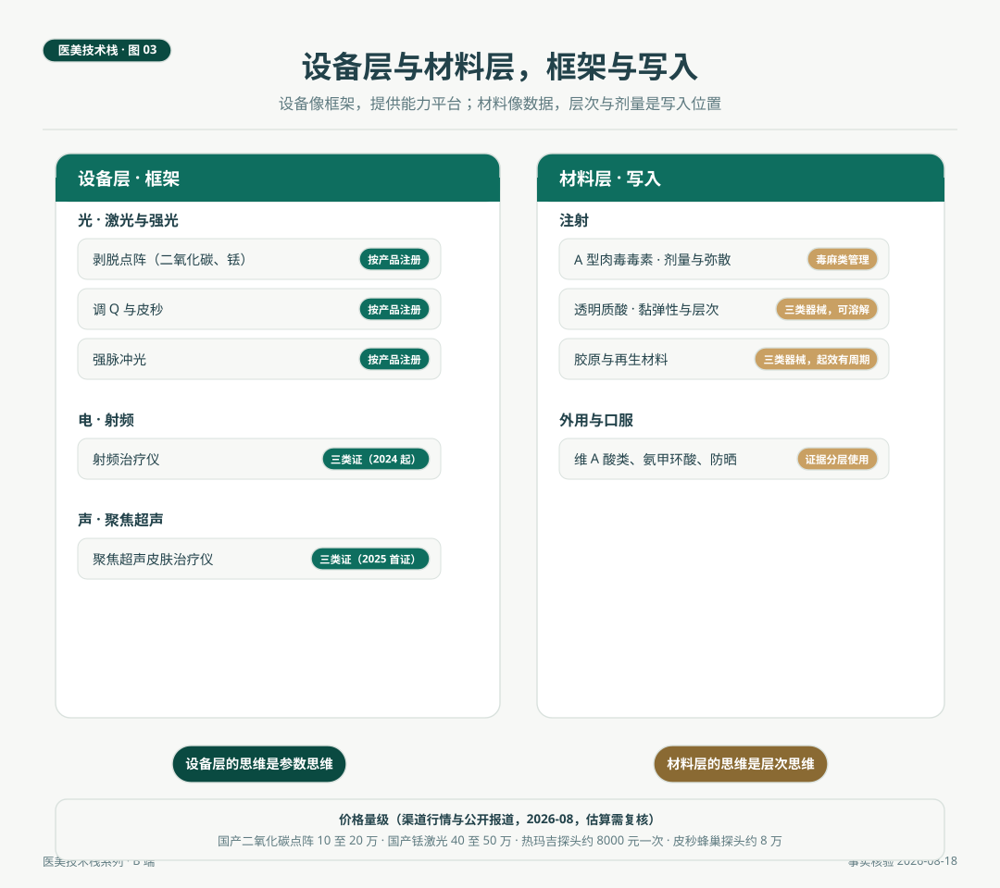

# 设备与材料，医生栈的两层核心

> 设备像框架，提供能力平台，医生在框架上开发的应用叫方案。材料像数据，层次是写入位置，剂量是写入量。框架思维看设备，核心是参数与注册类别。写入思维看材料，核心是层次、剂量与可逆性。两层合起来，构成医生日常工作的中间件，也是机构资本开支的主要去向。

*医美技术栈 · 第 03 篇 / 共 10 篇 · 医生篇 · 事实核验时间 2026 年 8 月 18 日*

---

## 场景与问题

2026 年年中，一家美容皮肤科诊所开季度采购会。老板提议再加一台设备，理由是隔壁机构刚上了新品。在座的主诊医生问了一个问题，我们过去三个月的主诉池里，排在前几位的是什么。答案是痘坑、暗沉、毛孔、私密。医生说，先看主诉池，再看设备池，顺序反了，钱就花成库存。这场讨论的实质，是把设备从采购标的放回医生技术栈的设备层，让它重新变成能力问题而不是资产问题。

## 一、框架思维看设备

IT 工程师选框架先看生态与成熟度，医生看设备先看两条，参数空间与注册类别。

参数空间决定一台设备能做什么。波长、脉宽、光斑、密度，四个维度张开的范围，就是这台框架的能力边界。以点阵激光为例，剥脱性与非剥脱性的区别在靶基与损伤模式，点阵密度是可以独立调节的变量，一项深肤色人群研究显示，高密度组（每平方厘米 393 个微热损伤区）炎症后色素沉着发生率 71%，低密度组（每平方厘米 220 个）为 43%。同一台设备，密度档位不同，风险结构就完全不同。参数思维的含义是，会评价一台设备，等于会读它的参数空间并把它对准具体的人群与主诉。

注册类别决定一台设备的合规位置。射频治疗仪自 2024 年 4 月 1 日起须持第三类医疗器械注册证方可生产、进口和销售，存量二类证过渡期已于 2026 年 3 月 31 日截止。聚焦超声皮肤治疗仪 2025 年 11 月出现国内首张三类证，品类刚进入规范供给的起点。激光类设备一直按具体产品注册证管理，路径稳定，国产供给充分。医生不需要背公告，但需要知道一个事实框架，不同品类的设备处在监管生命周期的不同位置，这影响机构的采购决策，也影响方案的可持续性。

**品类地图与价格量级（渠道行情与公开报道，2026 年 8 月，估算需复核）。**

| 品类 | 靶基逻辑 | 代表用途 | 价格量级 |
|---|---|---|---|
| 剥脱点阵（二氧化碳、铥） | 水吸收，气化与热刺激 | 痘坑、瘢痕、肿物 | 国产 10 至 20 万 / 40 至 50 万 |
| 非（微）剥脱点阵 | 水吸收，保留表皮 | 光老化、暗沉、黄褐斑辅助 | 国产铥为主 |
| 调 Q 与皮秒 | 黑素颗粒光机械爆破 | 深层色素、褐青色痣 | 进口 150 至 300 万 |
| 强脉冲光 | 宽谱，色素与血管兼顾 | 嫩肤、浅斑、红血丝 | 数十万量级 |
| 射频 | 真皮加热，胶原重塑 | 紧致抗衰 | 热玛吉整机 60 至 100 万，探头约 8000 元一次 |
| 聚焦超声 | 深层聚焦热凝固 | 深层紧致 | 三类证时代早期，供给有限 |

这张表的价格列是行业观察第 01 篇核验口径的延续，重点不是数字本身，是结构。有的设备成本以折旧为主，没有按次计价的正版耗材，有的设备利润结构与治疗量深度绑定。这个差别属于机构栈的经营系统，第 10 篇会回来。

## 二、写入思维看材料

设备层的能力是平台化的，材料层的能力是个性化的，因为写入有位置、有数量、有时效。

**A 型肉毒毒素。** 剂量以单位计，作用机制是神经肌肉接头的可逆阻断，弥散范围决定它适合的部位与人群。管理类别是毒性药品，采购与使用全程可追溯，这一层的合规动作是机构栈供应链系统的一部分。写入的特征是可代谢、可恢复，维持时间以月计，这使它成为风险结构最友好的写入之一。

**透明质酸。** 黏弹性与交联度决定支撑力与维持时间，层次决定形态结果。它最独特的是可逆性，透明质酸酶可以在紧急与不满意两种场景下溶解已写入的材料，这是栈图里少见的回滚机制。回滚机制的存在不等于鼓励随意写入，溶解本身是有创操作，预案与指征同样属于规范安全层。

**胶原与再生材料（PLLA、PCL）。** 这类材料的作用机制是刺激自身胶原再生，起效以周和月计，效果渐进且持续时间更长。写入逻辑与前两者不同，它是编译型而不是解释型，写进去的不是成品，是生成器。对应的能力要求是预期管理，客人需要在治疗前理解渐进起效的含义，这属于栈顶的沟通层。

**外用与口服。** 维 A 酸类、氨甲环酸、防晒，这一层的证据等级参差，核心能力是按证据分层使用。黄褐斑系列已经给出的立场在此适用，药物与防晒是黄褐斑治疗的基座，激光是辅助。

*图 3. 设备层与材料层全景。左侧设备按光、电、声三源分组并标注注册类别，右侧材料按注射与外用口服分组，底部为价格量级与两种思维方式。*

## 三、两层怎么配合

方案是两层配合的产物。行业观察第 01 篇的双激光组合给出了一个完整案例，剥脱点阵负责质地轴，铥激光负责色素与黏膜轴，序贯安排而不是同日叠加，理由是热损伤总量的控制。把那个案例放进本篇的框架，它说的是一件事，方案设计是在设备框架上协调材料写入的次序、层次与间隔。

两个可操作的配合原则。其一，次序原则，色素改善在前、质地重塑在后，可以减少剥脱术后色沉对前期效果的干扰。其二，间隔原则，同一区域不同治疗的间隔由组织修复周期决定，痘坑点阵的常规间隔是六至八周，这些数字来自共识与文献的常规安排，不是经验玄学。

## 自检清单

| 层 | 核对问题 |
|---|---|
| 参数 | 每台在用设备的四要素参数范围（波长、脉宽、光斑、密度）是否清楚 |
| 注册 | 每台设备的注册证类别与号段是否查验过原件 |
| 品类边界 | 主诉池里前五位的需求，现有设备池的覆盖与缺口是否画过图 |
| 剂量 | 常用注射项目的剂量单位与安全上限是否即时可答 |
| 可逆性 | 每种材料的可逆手段与不可逆边界是否成文 |
| 起效周期 | 每种材料的效果时间线是否进入了知情同意话术 |
| 配合 | 科室是否有按适应症分层的方案库，而不是按设备分的操作手册 |

## 结论与失效条件

设备与材料是医生栈的两层核心，设备层用框架思维读参数与注册类别，材料层用写入思维管层次、剂量与可逆性，两层配合的产物是方案。

失效条件如下。其一，价格数字为渠道行情与公开报道的量级估算，发布与采购前需按具体配置询价复核。其二，注册类别状态动态变化，尤其射频与超声品类处在切换期，使用前按药监局现行公告核验。其三，材料的适应症与禁忌以产品说明书与现行共识为准，本文不构成处方依据。其四，品类地图以非手术医美为场景，手术类器械另属外科栈。

两层核心之上，还有一个让它们真正兑现的地方，围治疗期。术前评估、术后修复、并发症处置与随访，价值的一半在治疗之外，这是第 04 篇的内容。

---

## 附 事实与来源清单

**监管时间线。** 射频三类管理（国家药监局 2024 年第 103 号公告及解读，二类证过渡至 2026 年 3 月 31 日）。聚焦超声首张三类证（2025 年 11 月，半岛聚焦超声皮肤治疗仪，公开报道）。激光类按产品注册证管理（药监局注册规则）。

**临床与数据。** 点阵密度与色沉的剂量关系（高密度组 71%，低密度组 43%，深肤色人群研究）。亚洲人群激光磨削后色沉患病率 11.1% 至 17.1%（人民日报健康客户端引述文献）。痘坑点阵间隔六至八周、三至五次一疗程（《中国痤疮瘢痕治疗专家共识（2021）》常规安排）。

**价格。** 国产二氧化碳点阵 10 至 20 万、国产铥激光 40 至 50 万（渠道行情，2026 年 8 月）。热玛吉整机 60 至 100 万、探头约 8000 元一次，皮秒 150 至 300 万、蜂巢探头约 8 万（公开报道）。均为估算项。

**方法说明。** 设备与材料的评价框架为本文提出的栈图体例，具体采购与用药决定由机构与执业医师按个案作出，本文不构成医疗与投资建议。
