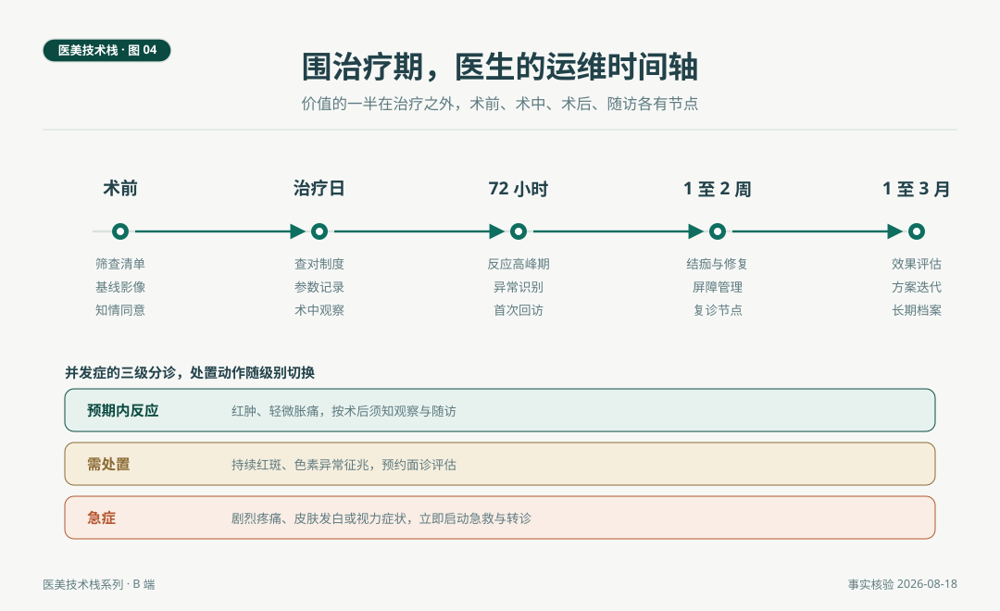

# 医生的运维，围治疗期管理

> 治疗结束的那一刻，效果才刚刚开始生长。术前筛查与基线影像、术中查对与参数记录、术后修复与并发症分诊、随访与档案，这些加起来是医生的运维能力，价值的一半在治疗之外。运维做得好不好，客人未必看得见，但每一次满意、每一次纠纷的走向，都由它决定。

*医美技术栈 · 第 04 篇 / 共 10 篇 · 医生篇 · 事实核验时间 2026 年 8 月 18 日*

---

## 场景与问题

2026 年 8 月的一个下午，一家诊所的医生接到术后回访电话。客人在外院做过两次点阵激光，这次在自家做完二氧化碳点阵第三天，红肿比记忆里明显。医生做的第一件事不是安抚，是调出术前的基线照片与当次参数记录。对照之后发现，这次密度比外院记录高了一档，红肿在预期范围内，处置是修复方案加紧随访。三天后复诊，恢复顺利。

这个场景里没有任何惊险，但每一步都踩在运维的节点上。没有基线影像，这次对照无从做起。没有参数记录，密度差异查不出来。没有回访制度，客人的焦虑会自己发酵。治疗效果由设备与手法决定，治疗体验与信任由运维决定，这一篇把围治疗期的时间轴完整走一遍。

## 一、术前，评估与筛查

术前的工作是三层。**筛查层**，妊娠与哺乳期、光敏史与光敏药物、疱疹复发史、瘢痕体质评估、近期维 A 酸类药物使用史，每一项都有对应的处理路径，阳性不等于拒绝服务，多数意味着方案调整或择期。**基线层**，标准化影像与皮肤分型记录，这是后续一切对照的锚点，标准化指同一角度、同一光线、同一表情，否则三个月后的对比没有意义。**沟通层**，知情同意的要素包括预期效果、恢复期、替代方案、并发症概率，概率语言是这一层的正式语言，效果承诺在这里属于违禁品。

## 二、治疗日，查对与记录

治疗日的核心动作有两个。**查对**，身份、项目、部位、材料批号，医疗行业的查对制度在这里原样适用，多项目联合时尤其重要。**记录**，设备参数、注射层次与剂量、耗材批号，全部进病历。第 03 篇场景里的参数对照之所以能实现，靠的就是这一步。病历的书写规范属于机构栈的流程系统，第 09 篇展开。

## 三、术后与随访，按设备走的恢复期

术后管理的第一依据是恢复期事实，不同设备的恢复期不同，术后须知不能一张纸通用。

| 项目类型 | 恢复期事实 | 术后要点 |
|---|---|---|
| 剥脱性点阵（二氧化碳） | 结痂五至七天，红斑可持续数周 | 结痂期保湿与防晒，禁止提前揭痂 |
| 非剥脱点阵（铥） | 红肿一至三天 | 短期修复，按疗程间隔推进 |
| 注射类（肉毒、填充） | 即刻轻微肿胀，数日内消退 | 24 至 48 小时避免高温环境与剧烈运动 |
| 光子嫩肤 | 基本无恢复期 | 冷敷与防晒 |

色沉是东亚人群术后随访的重点。亚洲人群激光磨削后炎症后色素沉着患病率为 11.1% 至 17.1%，这个数字决定了深肤色人群的随访节点要排得更密，防晒依从性要主动过问。黄褐斑人群的随访还有一条额外规律，1927nm 治疗后三至六个月复发常见，随访计划要按这个周期设计，而不是等客人上门再说。

随访节点的一般安排，治疗后一周查恢复，一至三个月查效果，长疗程项目按疗程节点滚动。每一次随访都是档案的一次更新，档案的连续性是长期关系的物质基础。

*图 4. 围治疗期五节点与并发症三级分诊。时间轴之上是常规节点，之下是按级别切换的处置动作。*

## 四、并发症的三级分诊

并发症处置的核心是分级，级别决定动作，分不清级别是多数慌乱的来源。三级划分如下。

**预期内反应。** 红肿、轻微胀痛、短暂发热感，属于术后须知已覆盖的范围，动作是解释、观察、按节点随访。这一级的关键是术前告知到位，让客人的预期里本来就装着这些反应。

**需处置。** 持续超过预期时间的红斑、色素异常征兆、注射后小结节的早期表现，动作是预约面诊、评估、按预案处理，例如浅层透明质酸结节的溶解评估。这一级的关键是识别窗口，越早面诊，处置选项越多。

**急症。** 剧烈疼痛、皮肤迅速发白或出现网状青斑、视力症状，血管栓塞的征象群，动作是立即启动急救流程，填充类材料按预案使用透明质酸酶，出现视力症状按第 02 篇提到的转诊路径争分夺秒。这一级的关键是事前成文的流程与定期演练，急症的表现形式容不得现场发挥。

分诊的语言要点。分级处置的意义是让每一个不良结果都有明确的归属路径，预期的归观察，可处置的归预案，急症归流程。这与本刊的医学不确定性立场一致，不良结果不等于医疗过错，但每一个结果都需要有清晰的处置与沟通动作。运维的成熟度，就体现在这条路径是否在事前铺好。

## 自检清单

| 阶段 | 核对问题 |
|---|---|
| 术前筛查 | 筛查表是否逐项执行并留档，阳性项是否有处理路径 |
| 基线 | 每位客人是否有标准化影像与分型记录 |
| 知情同意 | 是否使用概率语言，是否覆盖恢复期与替代方案 |
| 治疗日 | 参数、层次、剂量、批号是否全部进病历 |
| 术后须知 | 是否按设备类型分版本，而不是一张通用单 |
| 分诊 | 三级分诊标准是否成文，全员是否受过培训 |
| 急救 | 急救流程是否成文，最近一次演练是什么时候 |
| 随访 | 一周与一至三月节点是否有人负责触发 |

## 结论与失效条件

围治疗期管理是医生技术栈的运维层，术前评估与筛查、治疗日查对与记录、术后按设备走的修复管理、并发症三级分诊、按周期的随访，合起来把一次治疗变成一段可追溯、可兑现的医疗经历。

失效条件如下。其一，恢复期数字来自共识与文献的常规口径，个体差异存在，具体判断由主诊医师作出。其二，三级分诊是本文提出的框架，各机构应按自身科目与人员配置细化成文。其三，并发症概率数据为群体口径，不能用于个案承诺。其四，随访节奏因项目而异，表中安排为一般参考。

医生篇到此完整，七层栈从全景走到底层语言、两层核心与运维。下一个主体是医美咨询师，一个与医生同构而不同型的岗位，对标的是 IT 行业的售前顾问。咨询师的技术栈全景，是第 05 篇的内容。

---

## 附 事实与来源清单

**恢复期与数据。** 二氧化碳点阵结痂五至七天、红斑数周，铥激光红肿一至三天（点阵激光专家共识与临床文献，沿用行业观察第 01 篇核验口径）。亚洲人群激光磨削后色沉患病率 11.1% 至 17.1%（人民日报健康客户端引述文献）。1927nm 治疗黄褐斑三至六个月复发常见（好医术文献综述）。

**处置路径。** 透明质酸酶在填充并发症中的应用（《透明质酸面部填充不良反应的预防与治疗专家共识》）。眼动脉栓塞的介入再通路径（《介入血管再通术治疗额面部注射透明质酸美容致眼动脉栓塞视力受损专家共识》，2021）。

**制度依据。** 查对制度、病历书写属于医疗质量安全核心制度范围（国家卫生健康委《医疗质量安全核心制度要点》，2018），机构侧展开见第 09 篇。

**方法说明。** 三级分诊为本文提出的操作框架，不替代任何现行规范与个案医疗判断。本文不构成医疗建议。
