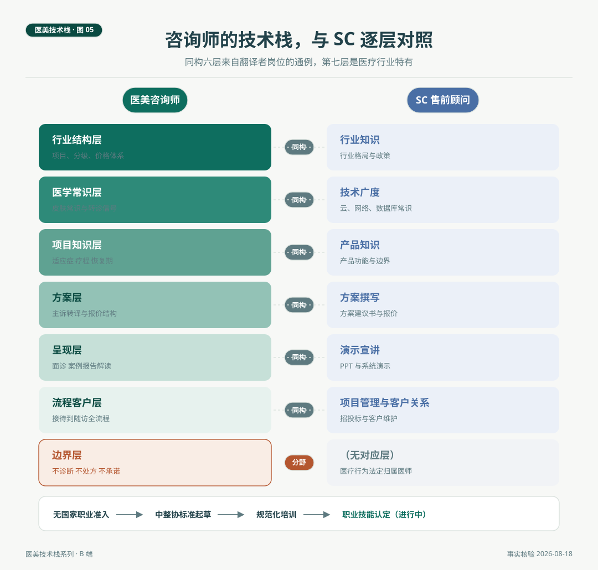

# 医美咨询师的技术栈全景

> 医美咨询师与 IT 行业的售前顾问高度同构，同样的翻译者定位，同样的广度优先，同样的方案与呈现双核。同构六层之上，医美多出第七层，边界层，不诊断、不处方、不承诺，四项医疗行为法定归属执业医师。这一层不是天花板，是专业性的来源。本篇给出咨询师的七层栈图，并对照 SC 逐层标注异同。

*医美技术栈 · 第 05 篇 / 共 10 篇 · 咨询师篇 · 事实核验时间 2026 年 8 月 18 日*

---

## 场景与问题

2026 年夏，一位做了六年 IT 售前的顾问转岗到一家医美机构做咨询师。入职第一周，她凭着旧习惯在工位白板上画了一张自己的技能图，行业知识、产品知识、技术常识、方案撰写、演示能力、客户维护，画完觉得心里有底。店长看了一眼说，结构是对的，但要改三处。哪三处，店长没说，让她自己想。三天后她交了答案。这一篇就把她改过的那张图完整画出来。

先说同构。售前顾问（Solution Consultant，业内常称 SC）是被行业充分栈图化的岗位，公开整理的通行结构包括行业知识、产品知识、技术广度、方案撰写、演示宣讲、招投标流程、客户关系，特点鲜明，广度优先，深度交给工程师，核心产出是方案与呈现。咨询师站在客人与医疗系统之间，做的是同一类翻译工作，把客人的主诉翻译成医疗语言，再把医疗方案翻译回客人听得懂的话。六个同构层由此而来，行业结构、医学常识、项目知识、方案、呈现、流程客户。

## 二、七层逐层看

**行业结构层。** 对标 SC 的行业知识。项目分类（手术与非手术、注射、光电、皮肤管理）、机构形态与项目分级常识、价格体系与成本结构常识。这一层给客人提供的价值是导航，知道行业怎么分层，才能告诉客人他站在哪里。

**医学常识层。** 对标 SC 的技术广度，但重心不同。SC 的技术广度以能用为限，咨询师的医学常识以知道边界为限，皮肤结构与分型常识、常见主诉地图（色素类、痤疮类、老化类）、需要立即交给医生的信号识别。这一层学得越透，越知道什么问题不属于自己，这与 SC 恰好相反，SC 怕答不上，咨询师怕答过头。

**项目知识层。** 对标 SC 的产品知识。每个主力项目的适应症、疗程结构、恢复期、禁忌、维持时间，项目之间的互补、序贯与互斥关系，产品与耗材的合规辨识常识。这是背诵量最大的一层，也是面诊信心的来源。

**方案层。** 对标 SC 的方案撰写。主诉转译、方案组合与优先级排序、报价结构设计，核心交付物是从主诉到报价的完整转译。第 06 篇单独展开。

**呈现层。** 对标 SC 的演示宣讲。面诊流程与提问技术、案例与影像对比的规范使用、检测报告的解读。SC 的战场是 PPT 与现场演示，咨询师的战场是面诊桌，兵器不同，功法相同，把复杂的专业信息讲成客人能做决定的语言。

**流程客户层。** 对标 SC 的项目管理与客户关系。接待到随访的完整流程、客户档案与随访节点、复购与转介绍的节奏设计。SC 管的是招投标时间线，咨询师管的是治疗时间线。

**边界层。** 医疗行业特有，SC 的栈里没有对应物。诊断、处方、治疗方案、操作实施四项医疗行为法定归属执业医师（《医疗美容服务管理办法》确立执业医师负责制），宣传口径受医疗广告法规约束。店长让她改的第三处就是这一处，白板上要为它单独画一层。第 07 篇单独展开。

*图 5. 咨询师七层栈与 SC 售前顾问栈逐层对照。六层同构，第七层分野，底部为咨询师岗位的职业化进程。*

## 三、店长指的三处修改

回到开头的悬念。那位转岗咨询师交出的三处修改，正好是两个行业栈图的全部差异。

第一处，技术广度层改写为医学常识层，学习目标从能用改为知道边界。第二处，方案层的终审权移交。SC 的方案建议书由售前自己定稿，咨询师的方案必须经过医生面诊确认，她的角色是准备材料、组织结构、呈现选项，医疗判断的最后一环永远在医生那里。第三处，新增边界层，把不能做什么画进能力图。她后来说，第三处最初想不通，把限制画进能力图算什么专业性。想通是因为一个对照，SC 行业里区分推销员与顾问的，从来不是话术，是对产品边界的诚实。咨询师行业里区分销售岗与医疗协作岗的，就是这一层。

## 四、职业化进程，可核验的事实

咨询师岗位当前没有国家职业资格准入，这是事实。中国整形美容协会组织专家起草了《医学美容咨询（设计）师国家职业技能标准》，并推行职业技能规范化培训，路径是标准开发、规范培训、职业技能认定三步推进。这两个事实合在一起，是这一层栈图的版本状态，正在从经验型走向标准型。这与监管十年补课是同一条时间线（参见「医美有那么糟糕吗」系列第 08 篇），行业的规则在追着行业的规模跑，咨询师的职业标准也在追着岗位的存量跑。

对这个进程持正面判断有依据。标准起草意味着这个岗位的知识开始公共化，培训体系意味着学习路径开始显性化，本系列画这张栈图，本身就是同一方向的努力。

## 自检清单

| 层 | 核对问题 |
|---|---|
| 行业结构 | 能否向新客人用五分钟讲清项目分类与价格结构 |
| 医学常识 | 五类转诊信号能否脱口而出（见第 07 篇清单） |
| 项目知识 | 每个主力项目的适应症、疗程、恢复期、禁忌、维持时间五问能否即时回答 |
| 方案 | 主诉到报价的转译是否有固定流程与工具表 |
| 呈现 | 案例展示是否符合广告合规要求，报告解读是否有标准话术库 |
| 流程客户 | 每位客人的档案与随访节点是否有专人维护 |
| 边界 | 四项医疗行为的边界能否向客人清楚解释 |

招聘用法。这份清单可以直接作为咨询师的面试核对表，逐层提问二十分钟，比聊经历更能核出真实水平。行业结构层问分类，项目知识层问五要素，边界层问红线，答得上来的候选人在栈上是完整的。

## 结论与失效条件

医美咨询师的技术栈是七层的广度型栈，六层与 SC 同构，边界层是医疗行业特有的分层。这张图把一个常被误解的岗位重新定义为医疗团队的协作岗，翻译者、流程管理者、档案维护者，专业性的来源是多出来的那一层，不是少掉的那一层。

失效条件如下。其一，栈图以非手术医美机构的主流岗位为原型，手术类机构的咨询师配置不同。其二，职业化进程动态推进，标准与培训状态使用前按中整协现行信息复核。其三，图是学习与自检的地图，不是对任何从业者专业性的评判标准。

方案层是七层中最见功力的一层，从一句想变好看到一张可执行的年度方案，中间的转译工程是什么样子，是第 06 篇的内容。

---

## 附 事实与来源清单

**SC 栈体例。** 售前顾问的通行技能结构（行业知识、产品知识、技术广度、方案撰写、演示宣讲、招投标流程、客户关系）参考行业公开整理的售前能力模型与岗位要求（知乎与牛客网售前岗位经验帖，腾讯云 SkillHub 售前工作台）。

**制度事实。** 执业医师负责制与医疗行为归属（《医疗美容服务管理办法》，卫生部令第 19 号，2022 年修订）。咨询师无国家职业资格准入、中整协起草《医学美容咨询（设计）师国家职业技能标准》并推行规范化培训（中国整形美容协会公开信息与行业报道）。

**方法说明。** 栈图为本文提出的体例，不构成对任何个人的能力认定。广告合规细节见第 07 篇核验。
