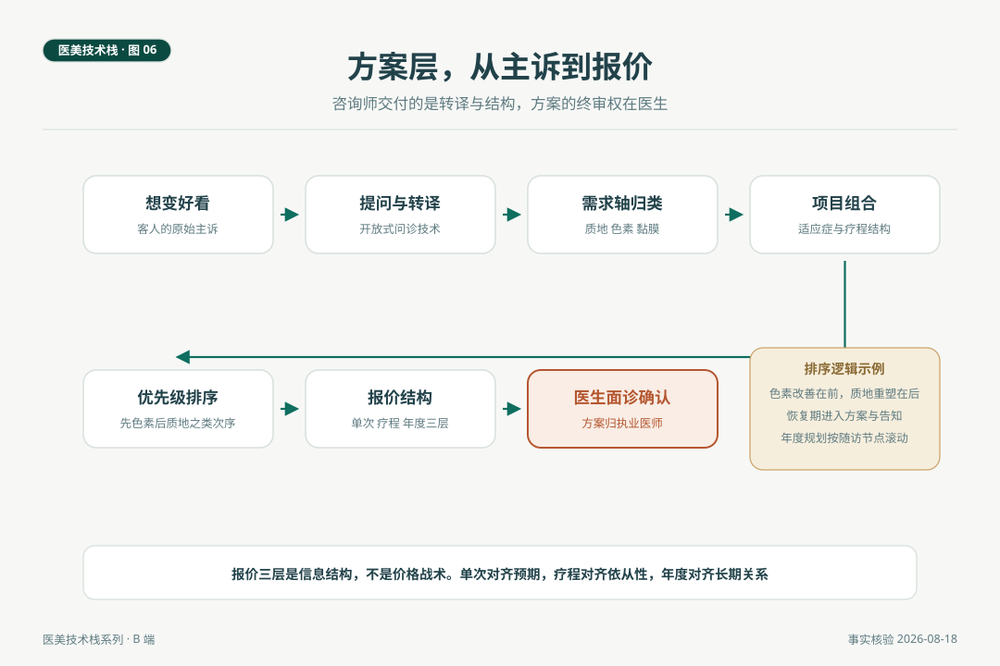

# 咨询师的方案层，从主诉到报价

> 客人坐下来的第一句话通常是想变好看，这句话距离一张可执行的方案隔着一整座加工厂。主诉转译、需求轴归类、项目组合、优先级排序、报价分层，咨询师方案层的五道工序都在这座工厂里。交付的是转译与结构，方案的终审权在医生，这条边界让方案层成为专业服务，而不是销售话术。

*医美技术栈 · 第 06 篇 / 共 10 篇 · 咨询师篇 · 事实核验时间 2026 年 8 月 18 日*

---

## 场景与问题

2026 年 8 月的一个上午，一位三十岁出头的客人在面诊桌前坐下，开场白是想变好看，预算大概两万。咨询师没有报项目，先问了四个问题。平时最介意脸上什么，照片里最先看哪里，之前做过什么，未来半年有什么重要场合。答案依次是暗沉和痘坑、整体肤色、只做过小气泡、两个月后有婚礼。二十分钟后，咨询师在白纸上画了三根轴，把客人的主诉归了位，给出一张分次序的方案单，末尾写着一句话，方案以医生面诊评估为准。客人当场说，这是我第一次听懂自己的脸。

这一篇复盘那二十分钟，把方案层的五道工序逐一讲清。

## 一、第一道工序，主诉转译

想变好看是一句真诚而无法执行的主诉，方案层的第一道工序是转译，把它翻译成可以归类的需求。工具是开放式提问，最介意什么、照片里先看哪里、重要场合的时间表，三问下来，主诉的真正落点通常自己浮出水面。这一道工序的纪律是先记录、不评判、不预设项目，客人说暗沉的时候，转译者的任务是追问暗沉出现在哪些场合、什么光线下，而不是心里先冒出一个项目名。

期望值的记录也在这一道。婚礼在前，意味着恢复期成为硬约束，时间表本身就是方案输入。期望值的沟通语言沿用本刊一贯的概率语言，医学给概率不给保证，这句话在方案层的位置是开头而不是结尾。

## 二、第二道工序，需求轴归类

转译后的需求按轴归类。沿用行业观察第 01 篇的三根轴，质地轴（痘坑、毛孔、轻中度松弛）、色素轴（浅表色斑、暗沉、黄褐斑）、黏膜与轮廓轴（私密、眼周、轮廓衔接）。轴的意义是让组合与排序有坐标系，暗沉归色素轴，痘坑归质地轴，一句想变好看被翻译成了两根轴上的两个具体问题。

归类的价值还在于边界清晰。三根轴之外的需求，例如明显的血管性问题或可疑皮损，不属于方案层的加工范围，直接进入转诊流程，这是第 07 篇的接口。

## 三、第三道工序，项目组合

组合调用的是项目知识层的五要素，适应症、疗程结构、恢复期、禁忌、维持时间。上例的组合结果是，色素轴用铥激光低能量改善暗沉并配合药物促渗，质地轴用点阵激光处理痘坑，间隔安排在婚礼前留足结痂恢复期。组合的依据是证据与共识层面的适应症匹配，例如剥脱性点阵激光是成熟期萎缩性痤疮瘢痕的共识一线推荐，1927nm 对深肤色人群的面部色素病变安全有效，这些不是销售卖点，是项目知识层的公共事实。

互斥关系在组合时同样要查。黄褐斑是典型例子，剥脱性方案不进入黄褐斑的常规选择，激光在黄褐斑方案中的角色是辅助与促渗通道，这不是项目不好，是匹配不对。

## 四、第四道工序，优先级排序

排序的逻辑是收益与干扰的最优平衡。通行原则有几条。色素改善在前、质地重塑在后，可以减少剥脱术后色沉对前期效果的干扰。恢复期长的项目避开客人的硬时间表。有创与无创穿插安排，让整体体验有节奏。上例的排序是婚礼前完成色素轴的无创或微创项目，质地轴的剥脱计划放在婚礼后启动，一张年度时间表就此成形。

排序是方案层最见经验价值的工序，因为它同时调用项目知识的五要素、客人的时间约束与皮肤状态，是典型的多变量决策。经验在这里的含义不是话术熟练，是约束条件的处理速度。

## 五、第五道工序，报价结构

报价不是排序完成后的标价动作，它本身有结构。三层结构是行业里健康的样子，单次体验对齐预期，疗程套餐对齐依从性，年度规划对齐长期关系。本刊在「小医美的大问题」第 06 篇讲过价格是信息，这个立场在方案层的应用就是报价分层，把单次、疗程、年度的价格与内容摆在明处，客人按自己的预算与节奏选择，而不是被组合套餐推着走。

上例的报价单对应三根时间线，婚礼前的密集方案、婚礼后的质地疗程、来年的维护规划，每一段的必要性都有医疗逻辑支撑。复购节奏以医疗需求为依据，不以销售指标为依据，这不是道德姿态，是长期信任的结构要求，第 10 篇会从机构经营侧再讲一遍这个道理。

*图 6. 方案层五道工序。主诉经转译与归类进入组合与排序，报价三层在末端成型，全程的最后一站是医生面诊确认。*

## 六、终审权在医生

方案单的最后一行字，方案以医生面诊评估为准，不是免责套话，是方案层的结构组成。咨询师交付的是转译与结构，医生签发的是医疗方案。这个分工的效率含义是，医生的面诊时间被用在最需要的判断上，而不是从零收集主诉，这正是 SC 与工程师协作的成熟模式在医疗场景的翻版。

## 自检清单

| 工序 | 核对问题 |
|---|---|
| 转译 | 面诊是否有固定的开放式提问流程，期望值是否记录在案 |
| 归类 | 主诉是否落到具体的需求轴上，轴外需求是否走转诊 |
| 组合 | 每个项目选择是否说得出适应症依据 |
| 互斥 | 方案里是否存在证据层面的互斥组合 |
| 排序 | 排序是否同时考虑了效果干扰与客人的时间约束 |
| 报价 | 是否三层分开呈现，价格与内容是否对应透明 |
| 终审 | 方案单是否固定载明以医生面诊评估为准 |

## 结论与失效条件

方案层是从主诉到报价的五道工序，转译、归类、组合、排序、分层报价，交付物是客人能看懂、医生能接手的方案结构。它的专业性体现在两头，前头的提问与转译功夫，后头的边界与终审安排。

失效条件如下。其一，本文案例为教学场景虚构，不指向任何真实机构与个人。其二，项目匹配的依据以现行共识与产品说明书为准，方案层不自行创造适应症。其三，报价分层是结构建议，具体价格由机构按成本与定位制定。其四，涉及医疗判断的一切环节归执业医师。

方案层之上还压着那一层医疗特有的边界。四项医疗行为归医生，宣传口径有执法指南划线，转诊信号有哪些，这是第 07 篇的内容，也是咨询师篇的收官。

---

## 附 事实与来源清单

**项目匹配依据。** 剥脱性点阵激光为成熟期萎缩性痤疮瘢痕一线推荐（《中国痤疮瘢痕治疗专家共识（2021）》）。1927nm 对深肤色人群面部色素病变安全有效，黄褐斑治疗以综合管理为主、激光为辅（点阵激光临床应用专家共识与文献，沿用行业观察第 01 篇与黄褐斑系列核验口径）。

**恢复期事实。** 剥脱性点阵结痂五至七天，非剥脱点阵红肿一至三天（共识与文献常规口径）。

**立场关联。** 价格是信息、概率语言、方案以评估为基座，分别见「小医美的大问题」第 06、08、05 篇。方法说明，本文不构成医疗建议与消费建议。
