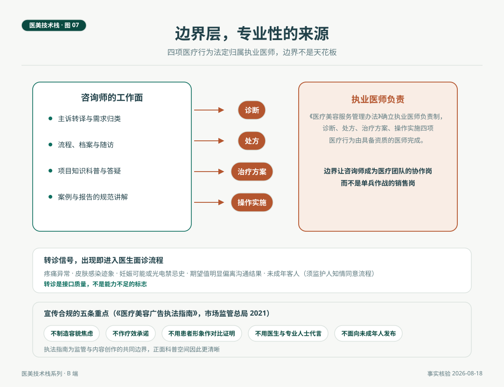

# 咨询师的边界层，专业性的来源

> 诊断、处方、治疗方案、操作实施，四项医疗行为法定归属执业医师，这是医美咨询师栈图里第七层的硬边界。宣传口径另有一条软边界，市场监管总局 2021 年的医疗美容广告执法指南划出五类重点情形。两条边界加起来不是咨询师的天花板，是这个岗位成为医疗协作岗的资质证明。边界画得越清楚，专业空间越宽敞。

*医美技术栈 · 第 07 篇 / 共 10 篇 · 咨询师篇 · 事实核验时间 2026 年 8 月 18 日*

---

## 场景与问题

2026 年 8 月的一次面诊，客人问了一个所有咨询师都被问过的问题，这个针打了一定有效吗。坐在这张桌前的咨询师给了两段式回答。第一段是证据与概率，这个项目的主要适应症人群里，多数人在若干周内看到改善，效果因个体代谢与生活习惯有差异，维持时间有文献区间。第二段只有一句，你属于哪种情况，医生面诊时会给你个体答案。客人点了点头，没有追问。

这个两段式回答是边界层的日常形状。前一段是知识，后一段是归属。这一篇把这一层的两条边界讲清楚，法定边界与宣传边界，再给出转诊信号清单。

## 一、法定边界，四项归医师

《医疗美容服务管理办法》确立执业医师负责制，医疗美容项目由具备资质的执业医师负责实施。落到岗位语言上，四项行为构成硬边界，诊断、处方、治疗方案、操作实施。客人问这是什么斑，答案是疑似方向的科普加面诊建议，不是诊断。客人问打多少单位，答案是剂量由医生评估，不是处方。客人拿着别家的方案来比较，答案是请医生评估其适配性，不是改方。客人要求今天加做一个项目，答案是排入医生评估流程，不是放行。

这四条的正面表述同样重要。边界之内的动作清单很长，主诉转译、项目科普、流程安排、档案维护、随访触达、报告解读、期望值沟通，第 05 篇的七层栈里，前六层的全部内容都在边界之内。边界层划掉的是四项，保住的是整个岗位的医疗协作属性。SC 行业的经验在此完全适用，区分推销员与顾问的从来不是话术水平，是对边界的诚实。

## 二、宣传边界，执法指南的五条重点

市场监管总局 2021 年发布《医疗美容广告执法指南》，这是首部专门针对医美广告的执法文件，划出的重点情形包括五类。不制造容貌焦虑，不得将容貌不佳与负面评价因素作不当关联。不作疗效承诺，不对诊疗效果与安全性作保证性宣传。不使用患者名义或形象作诊疗前后对比证明。不使用医生或专业人士为广告代言。不面向未成年人发布医美广告。

对咨询师而言，这五条不是外部的管制清单，是内容与话术的内建规则。案例展示只用合规形式，效果描述回到概率语言，容貌话题不与人生评价挂钩，未成年人咨询直接进入监护人知情同意的流程。执法指南的价值还可以正面读，它把合规的形状画了出来，正面科普的空间因此更清晰，讲机制、讲评估、讲概率、讲流程，这四讲都是宽敞大道。

*图 7. 边界层结构。左侧为咨询师的工作面，中间四项医疗行为归属右侧执业医师，下部为转诊信号与广告合规五条重点。*

## 三、转诊信号，边界层的接口

边界层不是一堵墙，是一组接口。以下信号出现时，对话从方案层切换到医生面诊流程，切换的速度与自然度是接口质量。

| 信号 | 含义 | 动作 |
|---|---|---|
| 疼痛或感觉异常的描述 | 可能超出预期反应范围 | 当日安排医生评估 |
| 皮肤感染迹象（红肿热痛加重、渗出） | 属于医疗处置事项 | 按机构流程即刻转医生 |
| 妊娠可能或光电禁忌史 | 禁忌筛查阳性 | 择期或调整方案 |
| 期望值明显偏离沟通结果 | 预期管理需要医生参与 | 安排深度面诊 |
| 未成年客人 | 须监护人知情同意流程 | 按规定流程办理 |

转诊不是能力不足的标志，是接口质量的展示。客人感知到的不是被推走，而是被更专业的资源接续，前提是转诊的解释话术同样成文，这属于呈现层与边界层的交叉训练。

## 四、为什么边界层是专业性的来源

三个理由。**制度理由**，四项归属由法规写定，边界内的协作岗位因此获得医疗团队的正式成员资格，销售岗没有这个身份。**信任理由**，客人对不承诺疗效、坦承概率的咨询师，长期信任显著高于对满口保证的咨询师，这是消费行为里反复验证的规律，也是本刊信任驱动立场的一贯内容。**职业化理由**，中整协起草咨询（设计）师职业标准、推行规范化培训的进程里，职业边界是标准的核心章节之一，一个正在被标准化的岗位，边界能力就是其可认证的专业能力。

回到开头的两段式回答。它之所以成立，是因为说话的人清楚知道哪一段属于自己的栈，哪一段属于医生的栈。边界层的修养，说到底是在自己这一段里做到最好，同时把下一段交到该交的人手里。

## 自检清单

| 项 | 核对问题 |
|---|---|
| 四项边界 | 诊断、处方、方案、实施四词能否准确解释并举例 |
| 话术 | 高频问题（有效吗、疼吗、能保持多久）是否备有证据加概率的标准答案 |
| 五条广告重点 | 案例与宣传物料是否逐条对照过执法指南 |
| 转诊 | 五类信号是否成文，转诊话术是否统一 |
| 未成年人 | 监护人流程是否明确到步骤 |
| 培训 | 边界层的岗前与复训是否有记录 |

## 结论与失效条件

边界层是咨询师栈图的第七层，法定边界四项归医师，宣传边界五条重点，转诊信号五类，合起来构成这个岗位与医疗系统的全部接口。边界内的工作面足够宽，边界处的动作质量决定岗位的专业成色。

失效条件如下。其一，法规条文以现行有效版本为准，发布与培训使用前需复核最新文本，各地实施细则可能有差异。其二，转诊信号清单是通行框架，各机构应按科目与人员配置细化。其三，本文涉法规陈述均为客观转述，不构成法律意见。

咨询师篇到此收官。系列的第三个主体是机构，栈的形态从个人技能变成组织系统，八个系统怎么搭、接口怎么接，是第 08 篇的内容。

---

## 附 事实与来源清单

**法规与指南。** 执业医师负责制与主诊医师制度（《医疗美容服务管理办法》，卫生部令第 19 号，2022 年修订）。《医疗美容广告执法指南》五类重点情形（市场监管总局 2021 年发布，重点打击制造容貌焦虑、违背社会良好风尚的广告行为，对未经审批的药品器械宣传等另有规定，具体以现行文本为准）。

**职业化进程。** 中整协《医学美容咨询（设计）师国家职业技能标准》起草与规范化培训（中国整形美容协会公开信息）。

**立场关联。** 信任驱动与预期管理见「小医美的大问题」第 08、09 篇，医学不确定性立场（不良结果不等于医疗过错）见本刊医学不确定性编辑立场。方法说明，本文不构成法律意见与医疗建议。
