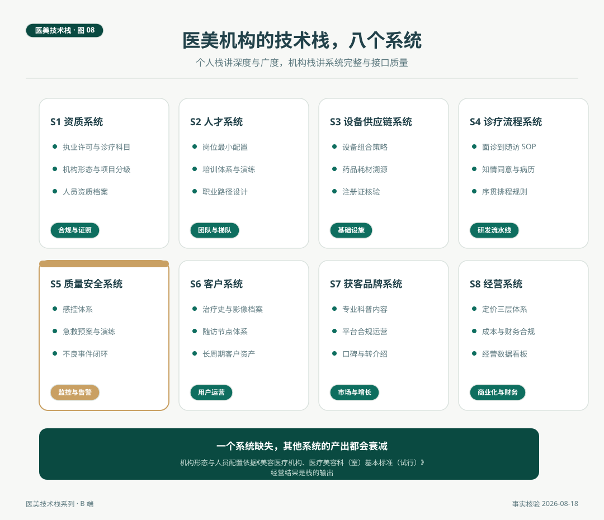

# 医美机构的技术栈全景

> 机构的栈不是个人技能的放大，是另一套语法。个人栈讲深度与广度，机构栈讲系统完整与接口质量。资质、人才、设备供应链、诊疗流程、质量安全、客户、获客品牌、经营，八个系统缺一个，其他系统的产出都会衰减。这一篇给出机构栈的全景图，每个系统都标注了制度依据与对标物。

*医美技术栈 · 第 08 篇 / 共 10 篇 · 机构篇 · 事实核验时间 2026 年 8 月 18 日*

---

## 场景与问题

2026 年 8 月，一家美容皮肤科诊所开业前两周，筹备期的投资人（本系列总览里那位画栈图的投资人）在白板上画了八个格子，让筹建团队逐格签字确认。资质格由医务负责人签，人才格由人事签，设备格由采购签，画到第五格质量安全的时候，会议室安静了一会儿，这一格的负责人此前一直空缺。当天下午，机构补上了这一格的人选，一位有公立医院感控背景的护理负责人。开业复盘时投资人说，八个格子签字那天，才是这家机构真正成立的那天。

这一篇把这八个格子逐一讲清。机构栈与个人栈的语法差异先行。

## 一、从个人栈到组织栈

医生栈的语法是纵向的，层与层有依赖关系，栈的深度决定个体的能力上限。咨询师栈的语法是横向的，广度与接口质量决定岗位的价值。机构栈的语法是网状的，八个系统互相依赖，任何一个系统的缺失或薄弱都会通过网络传导，拉低其他系统的产出。设备再好，流程不接，产能起不来。获客再强，质量不稳，口碑反噬。这是组织能力与个人能力最本质的差别，也是为什么机构的技术栈要单独画一张图。

## 二、八个系统逐一看

**S1 资质系统，机构的操作系统。** 《医疗机构执业许可证》与核准登记的诊疗科目是一切的前提，医疗美容科为一级诊疗科目，美容外科、美容牙科、美容皮肤科、美容中医科为二级科目。项目侧按《医疗美容项目分级管理目录》（2009）执行，美容外科项目分四级，不同级别对应不同的机构形态与人员条件，美容皮肤科项目不分级别，诊所形态即可开展。人员资质档案（医师注册、主诊备案、护士执业）也归这一系统，它是静态系统，但年检与校验时决定一切。

**S2 人才系统。** 人员配置有硬标准。《美容医疗机构、医疗美容科（室）基本标准（试行）》（卫医发〔2002〕103 号）规定，医疗美容门诊部每科目至少有一名本专业主治医师资格以上的主诊医师，并至少配备护师资格以上的护士；医疗美容医院每床（椅）至少配备 1.03 名卫生技术人员、0.4 名护士，至少有 6 名副主任医师资格以上的主诊医师。硬标准之上是软配置，培训体系（设备操作、急救演练、服务流程）与职业路径（医生的技术纵深、咨询师的专业化认证），人才系统的产出是其他所有系统的输入。

**S3 设备供应链系统。** 设备组合策略是行业观察第 01 篇的完整话题，结论在此引用，设备层的采购决策受主诉池结构约束，也受注册类别周期影响。供应链侧的动作包括药品耗材溯源（注射物批号可验真）、设备注册证核验（原件查验）、耗材成本结构管理。第 03 篇讲过射频与超声的注册切换时间线，这一系统的日常就是让每一台设备、每一支材料的来路都可查证。

**S4 诊疗流程系统。** 面诊到随访的标准流程（SOP）、知情同意与病历流程、多项目序贯的排程规则。这是机构的研发流水线，产出物是每一次标准化交付。第 09 篇单独展开。

**S5 质量安全系统。** 感控体系、急救预案与演练、不良事件上报与复盘、投诉处理。国家卫生健康委《医疗质量安全核心制度要点》（2018）列出的十八项制度（首诊负责、查对、病历管理、危急值报告等）是这一系统的制度骨架。这是医疗属性多出的系统，图里用金色标出，它与一般服务业的差距最大，也最不能省。

**S6 客户系统。** 治疗史与影像档案、随访节点体系、长周期客户资产管理。第 04 篇医生侧的随访动作，在机构侧由这一系统承接与维护。档案的连续性既是医疗质量的一部分，也是客户资产的物质形态。

**S7 获客品牌系统。** 专业科普内容、平台合规运营、口碑与转介绍体系。合规边界即第 07 篇的五条广告重点，正面读法是空间清晰，讲机制、讲评估、讲概率、讲流程的内容是这个系统的主场。

**S8 经营系统。** 定价体系（单次、疗程、年度三层）、成本与财务合规、经营数据看板。对标 IT 组织的商业化与财务。第 10 篇单独展开。

*图 8. 机构技术栈的八个系统。质量安全系统以金色标出，是医疗属性多出的系统。系统间为网状依赖，一个系统缺失，其他系统的产出都会衰减。*

## 三、系统之间的接口

八个系统不是并排的格子，是网络。三个关键接口值得单独点出。

资质与人才的接口。主诊医师备案的专业类别决定机构能开展的项目范围，人才招聘因此不是纯粹的人力问题，而是资质系统的一部分，这个接口错配，机构的能力边界就名不副实。

流程与质量的接口。SOP 是流程系统的产出，不良事件复盘是质量系统的产出，两者的闭环方式是复盘结论修订 SOP，流程版本滚动更新。这个接口的健康度，直接决定机构是从自己的错误里学习，还是重复自己的错误。

设备与经营的接口。设备采购属于供应链系统，约束条件来自经营系统（预算、回收期模型），效果兑现取决于人才系统（有没有能驾驭参数的医生）与流程系统（有没有配套的随访）。行业观察第 01 篇的设备决策，放在机构栈里看就是一个跨系统项目。

## 四、给 C 端读者的理解清单

机构栈图对消费者同样有用，换一种读法即可。一家机构把八个系统的信息摆在明处，执业许可与诊疗科目公示可查、人员资质上墙、流程有节点、随访有安排、价格分层透明，这是专业机构的结构样子。消费者读这张图，读的不是审查清单，是理解一家机构好在哪些系统上，从而把注意力放在值得问的问题上，例如你们的随访节点怎么安排，而不是只比价格。

## 自检清单

| 系统 | 核对问题 |
|---|---|
| 资质 | 执业许可、诊疗科目、人员备案是否齐备且在有效期 |
| 人才 | 人员配置是否达到基本标准，培训与演练是否有计划有记录 |
| 设备供应链 | 每台设备注册证、每支材料批号是否可查可溯 |
| 诊疗流程 | 面诊到随访是否有成文 SOP，执行是否有记录 |
| 质量安全 | 十八项核心制度是否逐项落地，不良事件是否有闭环机制 |
| 客户 | 档案是否连续完整，随访是否有专人触发 |
| 获客品牌 | 内容与投放是否对照广告指南逐条合规 |
| 经营 | 定价是否三层透明，看板指标是否真实取数 |

## 结论与失效条件

医美机构的技术栈是八个系统组成的网状组织能力，资质与人才是硬底盘，设备与流程是产能带，质量安全是中枢，客户、获客、经营是外部循环。经营结果是这八个系统的输出，不是营销预算的输出。

失效条件如下。其一，人员配置数字引自卫医发〔2002〕103 号文件的通行口径，各地执行细则有差异，筹建前需按当地卫健部门要求核对。其二，本篇以诊所与门诊部形态为主要场景，医院形态的栈更厚。其三，八个系统的划分是本文提出的体例，制度依据各自独立核验。

流程与质量安全这两个系统撑起机构的日常，标准流程怎么建，安全回路怎么转，是第 09 篇的内容。

---

## 附 事实与来源清单

**制度依据。** 诊疗科目与项目分级（《医疗美容服务管理办法》及《医疗美容项目分级管理目录》2009）。人员配置（《美容医疗机构、医疗美容科（室）基本标准（试行）》，卫医发〔2002〕103 号）。质量安全制度骨架（国家卫生健康委《医疗质量安全核心制度要点》，2018，十八项）。

**设备与价格。** 注册类别时间线与价格量级沿用行业观察第 01 篇核验口径（2026 年 8 月，估算项需询价复核）。

**方法说明。** 八系统划分为本文提出的栈图体例，不构成对任何机构的评价标准，也不构成投资建议。
