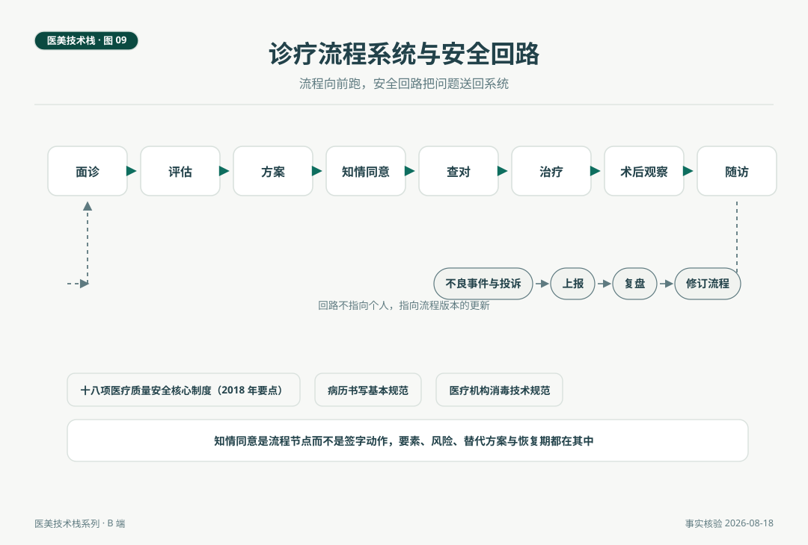

# 机构的流程与安全系统

> 把一次治疗组织成八个节点，每个节点有产出物，这是机构的诊疗流程系统。让每一个不良事件和投诉都变成流程版本的更新，这是机构的安全回路。流程向前跑，回路把问题送回来，两条线合成机构栈里最像工厂车间的部分，也是稳定交付与长期信任的制度来源。

*医美技术栈 · 第 09 篇 / 共 10 篇 · 机构篇 · 事实核验时间 2026 年 8 月 18 日*

---

## 场景与问题

2026 年 8 月的一个周二早晨，一家美容皮肤科诊所的例行演练日。剧本是模拟客人在注射后出现头晕与面色苍白，从护士发现异常、呼救、医生到场、生命体征测量到急救车到位，全程计时。第一次跑完用了六分钟，复盘会发现卡点在急救车位置与人员分工，调整后第二次跑进三分钟。没有真实事件发生，这一小时花得值不值，机构负责人在演练记录上写了一句话，流程的唯一产出是让下一次更顺。

这一篇讲机构栈的第四与第五个系统，诊疗流程与质量安全。它们是八个系统里最像工厂车间的部分，有流水线，有质检，有返工回路。

## 一、流程系统，八个节点与产出物

面诊、评估、方案、知情同意、查对、治疗、术后观察、随访，八个节点组成机构的诊疗流水线。流程系统成熟的标志不是墙上贴了流程图，是每个节点有明确的产出物与责任人。

| 节点 | 产出物 | 责任侧 |
|---|---|---|
| 面诊 | 主诉与病史记录 | 医生加咨询师 |
| 评估 | 分型、基线影像、禁忌筛查表 | 医生 |
| 方案 | 书面方案单（含概率语言告知） | 医生 |
| 知情同意 | 签署的知情同意书 | 医生 |
| 查对 | 查对记录（身份、项目、批号） | 医护 |
| 治疗 | 治疗记录（参数、层次、剂量） | 医生 |
| 术后观察 | 观察记录与术后须知签收 | 医护 |
| 随访 | 随访记录与档案更新 | 咨询师加医生 |

第 04 篇医生侧的围治疗期动作，全部嵌在这条流水线里。机构层的价值在于让流水线不依赖任何个人的记性，新人入职按节点培训，节点产出物齐全即流程合格，这是多店复制与质量控制的前提。

**知情同意的展开。** 知情同意是流程节点而不是签字动作。要素包括预期效果的概率表述、恢复期、替代方案、并发症及其发生率区间、费用构成。以黄褐斑的激光方案为例，三至六个月复发常见这一文献规律属于必写项，这不是自我保护的话术，是让客人的预期里本来就装着医学的不确定性。

**病历的展开。** 病历书写执行国家病历书写基本规范，门诊病历保存有法定年限要求（按现行规定自患者最后一次就诊起不少于 15 年，具体以现行文本为准）。病历在第 04 篇的参数对照场景里已经出现过一次，它的作用是把每一次治疗变成可追溯的记录，纠纷处理时是证据，效果评估时是数据，流程改进时是原料。

## 二、质量安全系统，制度骨架与回路

质量安全系统的制度骨架是国家卫生健康委《医疗质量安全核心制度要点》（2018）列出的十八项核心制度，首诊负责、三级查房（按机构适用范围）、查对、病历管理、危急值报告、抗菌药物分级管理等。对以非手术项目为主的诊所，落地重点是查对、病历、会诊与转诊、危急值报告这几项。

**感控。** 医疗机构消毒技术规范是执行标准，重复使用器械的消毒灭菌记录、一次性耗材的使用与销毁、治疗室的环境管理，构成感控的日常。感控的特点是没有新闻就是最好的新闻，它的全部价值体现在什么都不发生。

**急救。** 急救预案成文、急救车与药品配置到位、定期演练，三个动作合起来才是完整的急救能力。开篇的演练场景是这一系统的日常形态。急救演练的频率按机构制度安排，通行做法是定期全员演练并留档，演练记录本身就是监管检查与保险核验的常见材料。

**不良事件闭环。** 这是安全回路的核心。上报、复盘、修订流程，三步闭环的要义有两点。其一，回路指向流程版本而不是个人，否则上报会枯竭。其二，复盘结论必须落成流程修订，否则复盘只是仪式。用 IT 的语言说，这是生产系统的监控与告警，告警的价值在于触发部署新的版本，而不是追究值班工程师。

**投诉与纠纷。** 投诉处理有明确的上位依据，《医疗纠纷预防和处理条例》（2018）规定了投诉接待、纠纷处理的路径与医患沟通机制。机构侧的成熟做法是把投诉也接入安全回路，投诉是客诉视角的流程缺陷信号，与不良事件共用复盘机制。这与本刊的医学不确定性立场衔接，不良结果先分诊再定责，机构的责任是把每一次结果的处理路径走稳。

*图 9. 上行为诊疗流程八节点的流水线，下为不良事件与投诉的安全回路，复盘结论回流为流程版本的更新。*

## 三、流程与安全为什么是信任的基础设施

这两个系统不直接产生收入，但它们决定收入的质量。复购的前提是交付稳定，交付稳定的前提是流程标准化。口碑的前提是不出系统性问题，而出问题的概率管理靠的正是安全回路。从客人的视角看，一家机构的流程感（等几次、查什么、谁负责、出问题找谁）与安全感（出了反应怎么办、找谁、多快）是体验里最底层的部分，它们由这两个系统直接供给。

对经营者的一个提醒。流程与安全系统的投入在财务报表上是成本项，在机构栈的语法里是产能与信任的基础设施，压缩这两项省下的钱，会以复购率、口碑与纠纷成本的形式连本带息地回到损益表上。这是第 10 篇经营系统的账要从这里算起的原因。

## 自检清单

| 项 | 核对问题 |
|---|---|
| 流程 | 八节点是否成文，每节点产出物是否明确 |
| 知情同意 | 要素是否齐备，概率语言是否进入模板 |
| 病历 | 书写是否规范，保存年限与调阅流程是否明确 |
| 感控 | 消毒灭菌记录是否连续，一次性耗材管理是否闭环 |
| 急救 | 预案是否成文，最近一次演练的记录在哪里 |
| 不良事件 | 上报渠道是否畅通，复盘是否落成流程修订 |
| 投诉 | 处理路径是否明确，是否接入复盘机制 |

## 结论与失效条件

诊疗流程系统把治疗组织成有产出物的八节点流水线，质量安全系统用制度骨架、感控、急救与不良事件闭环守住底线，两条线合成机构稳定交付的能力，是复购与口碑的基础设施。

失效条件如下。其一，十八项核心制度按机构类别与规模适用范围不同，落地清单以当地卫健部门要求为准。其二，病历保存年限与书写规范以现行有效文本为准，发布前复核。其三，演练频率与急救配置按机构科目配置细化，本文不设统一数字。其四，本文不构成法律与合规意见。

流程与安全是机构的内功，经营与客户是机构的外循环。定价怎么分层、客户资产怎么积累、看板看哪三个数，是第 10 篇的内容，也是系列的收官。

---

## 附 事实与来源清单

**制度依据。** 《医疗质量安全核心制度要点》（国家卫生健康委，2018，十八项）。病历书写与保存（病历书写基本规范、医疗机构病历管理规定，保存年限以现行文本为准）。《医疗纠纷预防和处理条例》（2018）。消毒感控（医疗机构消毒技术规范）。

**临床关联。** 恢复期与随访节点数据沿用第 04 篇与行业观察第 01 篇核验口径。黄褐斑三至六个月复发规律（文献综述）。

**方法说明。** 八节点流程与安全回路的框架为本文提出的体例，制度条文的执行以现行有效版本与当地要求为准。本文不构成法律意见。
